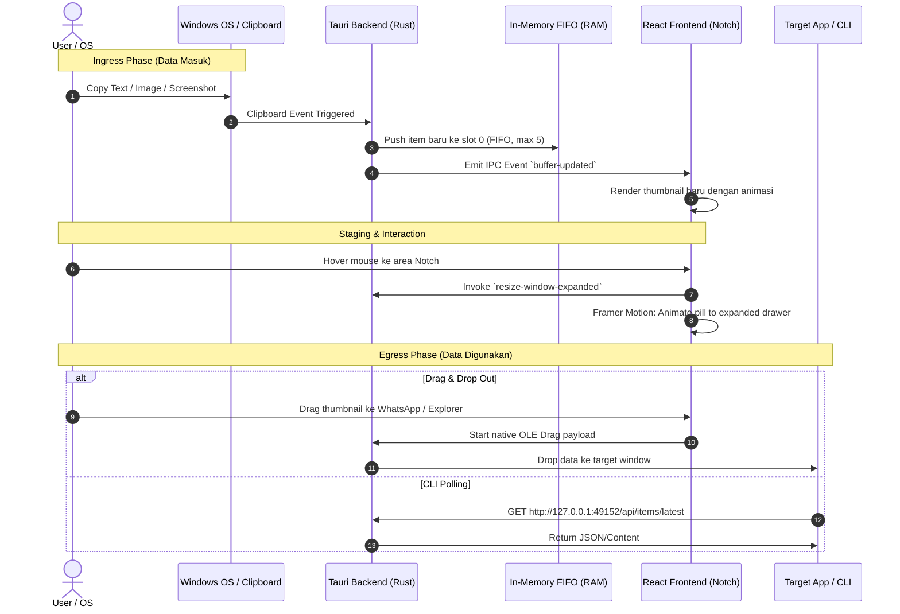

# Technical Stack & Architecture Specification (TECHSTACK.md)
**Project**: Dynamic RAM Notch Clipboard Manager  
**Version**: 1.0.0  
**Target Platform**: Windows 10 / Windows 11 (x64)

---

## 1. Executive Summary & Design Principles

Sistem ini dirancang sebagai aplikasi *background utility* Windows yang ringan, hemat daya, dan responsif. Arsitektur mengutamakan:
1. **Zero-Disk Clutter / Volatile RAM**: Semua item clipboard dan staging sementara disimpan hanya di memori (RAM), hilang otomatis saat aplikasi ditutup/reboot.
2. **Minimal Footprint**: Target penggunaan RAM idle < 50 MB (menghindari bloatware Electron).
3. **Fluid Micro-Interactions**: UI bergaya *Dynamic Island* dengan animasi elastis (*spring physics*) yang mulus.
4. **Non-Intrusive Windowing**: Notch menempel di bagian atas tengah layar (*frameless, transparent, always-on-top*), dan tidak menghalangi klik pada aplikasi di bawahnya saat dalam keadaan menciut (*collapsed*).

---

## 2. Core Tech Stack Selection

```
┌─────────────────────────────────────────────────────────────┐
│                      FRONTEND LAYER                         │
│  React 18/19 + TypeScript + Vite + Tailwind CSS             │
│  Animation Engine: Framer Motion                            │
│  Iconography: Lucide React                                  │
└──────────────────────────────▲──────────────────────────────┘
                               │ IPC (Tauri Commands & Events)
┌──────────────────────────────▼──────────────────────────────┐
│                    DESKTOP RUNTIME & CORE                   │
│  Tauri v2 (Rust)                                            │
│  WebView: Microsoft Edge WebView2 (Native Windows)          │
└──────────────────────────────▲──────────────────────────────┘
                               │ Native OS Layer
┌──────────────────────────────▼──────────────────────────────┐
│                    WINDOWS OS INTEGRATIONS                  │
│  - Clipboard Listener (Win32 AddClipboardFormatListener)    │
│  - Window Management (Frameless, Transparent, WS_EX_TOPMOST)│
│  - Native Drag-and-Drop Egress (OLE DoDragDrop / Plugin)    │
│  - System Tray (Tauri TrayIcon)                             │
│  - Local HTTP Server (Tiny-HTTP / Axum on localhost)        │
└─────────────────────────────────────────────────────────────┘
```

### A. Runtime & Desktop Shell: **Tauri v2 (Rust)**
* **Kenapa Tauri v2?**:
  * Menggunakan **WebView2** yang sudah terinstal secara bawaan di Windows 10/11, sehingga ukuran installer sangat kecil (<15 MB) dan penggunaan RAM idle hanya ~25–45 MB.
  * Backend ditulis dalam **Rust**, memberikan performa tingkat native, keamanan memori, serta akses langsung ke Win32 API tanpa overhead.
  * Dukungan native untuk System Tray, manipulasi ukuran window secara dinamis, dan event listener multi-thread.

### B. Frontend & UI: **React + TypeScript + Vite**
* **Styling**: **Tailwind CSS** untuk utility-first styling, rounded pill, glassmorphism / translucent backdrop blur (`backdrop-blur-md`).
* **Animation Engine**: **Framer Motion** untuk menganimasikan transisi dari pil kecil (*collapsed pill*) ke panel staging penuh (*expanded shelf*) dengan kurva *spring* yang responsif.
* **Icons**: **Lucide React** untuk ikon close, drag handle, indikator file, dan tipe data.

### C. In-Memory State & Buffer: **Rust FIFO Queue**
* **Struktur Data**: `VecDeque<ClipboardItem>` dengan kapasitas maksimum 5 item.
* **Payload Handling**:
  * Teks: Disimpan sebagai `String` UTF-8 murni.
  * Gambar/Screenshot: Disimpan di memori sebagai buffer byte / PNG encoded Base64.
  * File: Disimpan sebagai URI/Path lokal Windows (`file:///...`).
* **Karakteristik**: Ketika item ke-6 masuk, item tertua (index 4) otomatis didorong keluar (*evicted*) dari RAM.

### D. Native Egress & Drag-Out: **`tauri-plugin-drag` / Win32 OLE**
* Mengizinkan thumbnail di dalam notch ditarik (*drag-out*) keluar jendela browser ke software lain (File Explorer, WhatsApp, Discord, Browser) sebagai payload file/gambar native.

### E. CLI & Scripting Integration: **Local HTTP Server**
* Server HTTP mini embedded di Rust (misal: `127.0.0.1:49152`) untuk integrasi CLI eksternal (seperti Antigravity CLI).
* **Endpoints**:
  * `GET /api/items`: Mengembalikan daftar 5 item staging (format JSON).
  * `GET /api/items/latest`: Mengambil payload item terbaru untuk langsung di-pipe ke command prompt.
  * `DELETE /api/items/:id`: Menghapus item tertentu dari antrean.

---

## 3. Detail Arsitektur Sistem



---

## 4. Window Behavior & Layout Specifics

1. **Koordinat & Posisi**:
   * Posisi horizontal: `X = (ScreenWidth / 2) - (WindowWidth / 2)` (tengah layar).
   * Posisi vertikal: `Y = 0` (menempel di bezel atas monitor).
2. **Dimensi State**:
   * **Collapsed (Idle)**: Lebar ~140px, Tinggi ~8px – 12px (berupa garis/pil tipis minimalis hitam tembus pandang).
   * **Expanded (Hover / Active)**: Lebar ~420px, Tinggi ~80px – 100px (menampilkan 5 slot thumbnail dengan tombol hapus `x`).
3. **Window Styles (Win32 Attributes)**:
   * `always-on-top`: `true` (jendela selalu berada di layer paling atas).
   * `decorations`: `false` (tanpa titlebar, tombol minimize, atau border Windows).
   * `transparent`: `true` (latar belakang jendela transparan, hanya komponen visual notch yang terlihat).
   * `skip-taskbar`: `true` (tidak muncul di taskbar bawah, hanya ada di System Tray).

---

## 5. Ringkasan Kebutuhan Environment & Prerequisites

Untuk mengeksekusi project ini, environment pengembang memerlukan:
* **Node.js**: v18+ (dengan pnpm / npm / yarn)
* **Rust & Cargo**: Versi stable terbaru
* **Build Tools**: Microsoft C++ Build Tools (MSVC v142/v143)
* **Windows WebView2 Runtime**: Sudah terpasang bawaan di Windows 10 & 11.
